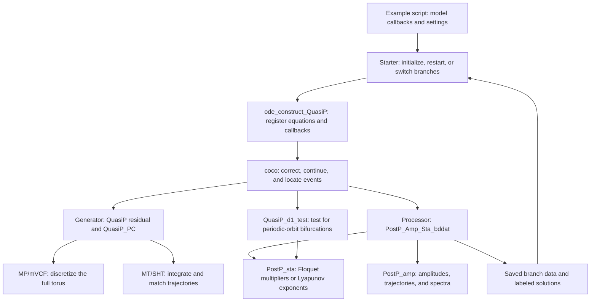

# QuasiP Program Structure

QuasiP organizes its code into a **Starter**, a **Generator**, and a **Processor**. An example script supplies the model callbacks and numerical settings, constructs a COCO problem, and invokes `coco(...)`. During correction and continuation, COCO calls the residual, phase conditions, event tests, and output callbacks registered by QuasiP.



## 1. Starter

| Entry point | Inputs and role | Next call |
|---|---|---|
| [`ode_isol2QuasiP`](ode_isol2QuasiP.m) | Takes model callbacks, the initial Fourier representation `Xk_MF`, the response frequencies `Om`, and the model parameters `p`. Builds the discretization and initial unknown vector. | [`ode_construct_QuasiP`](ode_construct_QuasiP.m) |
| [`ode_QuasiP2QuasiP`](ode_QuasiP2QuasiP.m) | Restores a saved solution and discretization using the run name and solution label. Updates parameter names for the new instance. | `ode_construct_QuasiP` |
| [`ode_TR2QuasiP`](ode_TR2QuasiP.m) | Reads a labeled periodic-orbit torus bifurcation (`TR`). Uses the critical Floquet multiplier and eigenvector to predict a two-frequency torus. | Sets `d=2` and calls `ode_isol2QuasiP` with the predicted Fourier data and frequencies. |
| [`ode_BP2QuasiP`](ode_BP2QuasiP.m) | Reads a saved branch point (`BP`) and retrieves the secondary branch tangent from the COCO chart field `lsol.v`. | Passes the tangent as `sol.t0` to `ode_construct_QuasiP`. |

All three saved-solution starters use [`QuasiP_read_solution`](QuasiP_read_solution.m). A regular restart reuses the saved discretization. The TR starter builds a new problem so the target formulation can be mVCF or SHT. For an MP periodic source run, it can reconstruct full displacement and velocity histories from the saved coefficients if only selected outputs were stored.

The initial construction path is:

```text
ode_isol2QuasiP
├─ QuasiP_get_seeting → COM_PHI → MP_mVCF_COM_PHI or MT_SHT_COM_PHI
├─ QuasiP_pnames_update / QuasiP_system_identify
├─ MT_SHT_COM_PHI_Supplement (for MT/SHT)
├─ QuasiP_init_sol → INITIAL_C_byPHI → method-specific coefficient conversion
├─ QuasiP_arg_check / QuasiP_init_data
└─ ode_construct_QuasiP
```

[`QuasiP_get_seeting`](QuasiP_get_seeting.m) merges options and builds `data.PHI`. [`QuasiP_system_identify`](QuasiP_system_identify.m) identifies the ODE form and available model derivatives. [`QuasiP_init_sol`](QuasiP_init_sol.m) assembles `sol.u=[C(:);Om(:);p(:)]`, and [`QuasiP_init_data`](QuasiP_init_data.m) records the indices of these blocks. Here `C` denotes the numerical solution coefficients.

## 2. Generator

[`ode_construct_QuasiP`](ode_construct_QuasiP.m) registers [`QuasiP`](private/QuasiP.m) as a COCO zero function and exposes model parameters, prescribed excitation frequencies, and unknown response frequencies. For `d>e`, it registers [`QuasiP_PC`](private/QuasiP_PC.m) to impose one orthogonal phase condition per unknown frequency. Here `d` is the number of response base frequencies and `e` is the number of excitation base frequencies.

| Formulation | Residual and Jacobian | Phase condition |
|---|---|---|
| **MP/mVCF** | [`MP_mVCF_COM_PHI`](private/MP_mVCF_COM_PHI.m) constructs basis, sampling, and differentiation operators for the HB, CO, or FD discretization in each direction. [`MP_mVCF_QuasiP`](private/MP_mVCF_QuasiP.m) reconstructs physical samples, evaluates the model and its derivatives, and projects them back to coefficient space. | [`MP_mVCF_QuasiP_PC`](private/MP_mVCF_QuasiP_PC.m) |
| **MT/SHT** | [`MT_SHT_COM_PHI`](private/MT_SHT_COM_PHI.m) constructs the shooting segments and transverse phase grid. [`MT_SHT_QuasiP`](private/MT_SHT_QuasiP.m) integrates the trajectory family and dispatches to the [HT residual](private/MT_SHT_HT_QuasiP.m) or [MF residual](private/MT_SHT_MF_QuasiP.m). These functions enforce segment continuity and phase-shifted closure. | [HT phase condition](private/MT_SHT_HT_QuasiP_PC.m) or [MF phase condition](private/MT_SHT_MF_QuasiP_PC.m) |

- **mVCF transforms.** The `MP_mVCF_U2S_*` routines in `private/` map coefficients to physical samples. The `MP_mVCF_S2U*` routines project sampled values and force derivatives back to coefficient space.
- **SHT integrators.** `PHI.ODEsolver` selects the integrator. MATLAB solvers are wrapped by [`MT_SHT_MATLABsolver1`](private/MT_SHT_MATLABsolver1.m). The fixed-step second-order [`Newmark`](MTSHT_ODEsolvers/Newmark.m) integrator uses [`MT_SHT_get_MDK_Cons`](MTSHT_ODEsolvers/MT_SHT_get_MDK_Cons.m) and [`MT_SHT_MDKF_var`](MTSHT_ODEsolvers/MT_SHT_MDKF_var.m) for the scaled equations and sensitivities. For unit period multiplication and one segment, `L1` determines the step count per excitation period and `dphi1=2*pi/L1` is passed to `Newmark`.
- **Model callbacks.** Example scripts supply the right-hand side `F`, linear operators `L`, and applicable derivatives `DFDX`, `DFDP`, and `DFDTH`. These differentiate the right-hand side with respect to the state, model parameters, and excitation phases. See [`ode_isol2QuasiP`](ode_isol2QuasiP.m) for the interface.

## 3. Processor and Bifurcation Tests

[`PostP_Amp_Sta_bddat`](misc/PostP_Amp_Sta_bddat.m) is the COCO `bddat` callback. It extracts `C`, `Om`, and `p` from the current chart and uses `amp_opts` and `sta_opts` to determine which branch columns to produce.

| Task | Entry point | Implementation |
|---|---|---|
| Reconstruct amplitudes, waveforms, and spectra | [`PostP_amp`](misc/PostP_amp.m) | The [MP processor](misc/MP_mVCF_PostP_amp.m) reconstructs the response from coefficients. The [SHT processor](misc/MT_SHT_PostP_amp.m) reconstructs it from integrated trajectories. |
| Compute stability | [`PostP_sta`](misc/PostP_sta.m) | [`MP_PostP_sta_Psi`](misc/MP_PostP_sta_Psi.m) or [`MT_SHT_PostP_sta_Psi`](misc/MT_SHT_PostP_sta_Psi.m) supplies state-transition data. The processor evaluates Floquet multipliers for periodic solutions and Lyapunov exponents for quasi-periodic solutions. |
| Locate periodic-orbit bifurcations | [`QuasiP_d1_test`](QuasiP_d1_test.m) | When `d=1` and stability analysis is enabled, this routine registers fold (`FP`), period-doubling (`PD`), and torus (`TR`) tests for COCO. COCO can also report `FP` through its geometric fold test. |

Examples of saved columns are `Max_x` for amplitudes, `MF_f` and `MF_x` for frequency combinations and spectral coefficients, and `Ly` and `Stab` for stability. The TR starter requires the state-transition history `Psi` at the source label. Setting `store_all_psi=false` on a periodic run retains that history at TR points.

## 4. Where to Look

| To inspect or change | Start here |
|---|---|
| Initialization, restart, or branch switching | Top-level `ode_*.m` files and [`QuasiP_read_solution`](QuasiP_read_solution.m). |
| Harmonic orders, sampling grids, period factors, or shooting segments | The example's `PHI_INITIAL` settings and [`COM_PHI`](private/COM_PHI.m). |
| Residuals, Jacobians, or phase conditions | [`QuasiP`](private/QuasiP.m) and [`QuasiP_PC`](private/QuasiP_PC.m), then the method-specific implementation. |
| Shooting integration and sensitivity propagation | `MTSHT_ODEsolvers/` and [`MT_SHT_MATLABsolver1`](private/MT_SHT_MATLABsolver1.m). |
| Saved amplitudes, spectra, or stability | The `PostP_*.m` files in `misc/`. |
| Installation and example run order | The [QuasiP README](../README.md) and the README in each example directory. |
